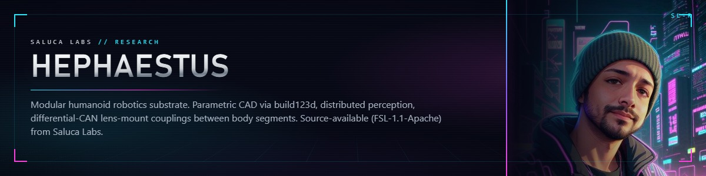
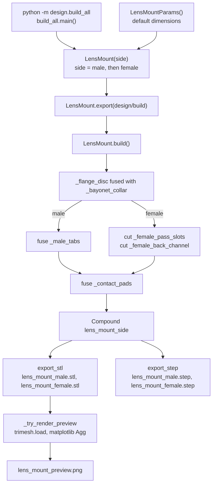
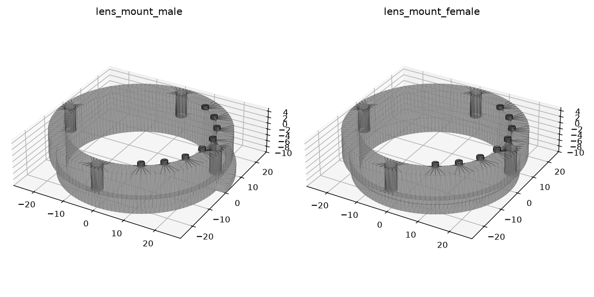

# Hephaestus

Modular humanoid robotics substrate: the open design home for a humanoid built from smart body segments, starting with a parametric lens-mount coupling generated in Python with build123d.

> **Correction, 2026-10-22.** This README said the licence was MIT (in "Repo layout" and "License"). Since commit `cfdb8e0` (2026-08-18) the [LICENSE](LICENSE) file is the Functional Source License 1.1 with an Apache 2.0 future licence (FSL-1.1-ALv2). Commits before `cfdb8e0` were published with an MIT LICENSE file.
>
> **Correction, 2026-10-22.** The quick start said that `pip install build123d` followed by `python -m design.build_all` writes STL, STEP and PNG previews. With only build123d installed, the PNG preview is skipped (`[preview] skipped: ModuleNotFoundError("No module named 'matplotlib'")`); the preview also needs `matplotlib` and `trimesh`. The install line below includes them.

## Status

Pre-alpha, exploratory R&D. Phase 0 in flight.

What the code on `main` does, checked 2026-10-22 at `cfdb8e0`: one part, the lens-mount coupling (`design/lens_mount.py`), builds in male and female versions and exports watertight STL meshes, STEP files and a preview PNG. Nothing else in the repository is code; every other item below is design intent from [docs/ARCHITECTURE.md](docs/ARCHITECTURE.md) and [docs/ROADMAP.md](docs/ROADMAP.md).

**Known issue, found 2026-10-22.** The generated geometry has **one** tab on the male part and **one** pass-through slot on the female part, not the three that `lens_mount.py` describes (`n_tabs=3`). In `_male_tabs` and `_female_pass_slots`, each wedge is rotated and then positioned with `locate(Location((0, 0, z)))`, which sets an absolute location and discards the rotation, so all three wedges land on the same 0 to 50 degree arc and fuse into one. Measured: the fused tab solid has the volume of exactly one wedge (173.44 mm^3). The preview under [Screenshots](#screenshots) shows the single tab. No fix is in this repository yet.

**Known issue, found 2026-10-22 (phase 2 docs pass).** The two halves as generated do not interlock. The female collar has the same 50 mm outer diameter and 44 mm bore as the male collar (both come from `_bayonet_collar`), so neither collar fits inside the other. The female cutters (`_female_pass_slots`, `_female_back_channel`) span radius 24.7 to 28.3 mm, which is almost entirely outside the collar wall (radius 22 to 25 mm): they remove only a 0.3 mm skin from the outside of the collar and a 0.3 mm notch under the flange, 189.77 mm^3 in total, measured. The male tab (radius 25 to 28 mm) therefore has no female slot or channel to enter. The module docstring's "matching pass-through slots plus a back channel that captures the tabs" describes the intent, not the geometry. No fix is in this repository yet.

Both measurements re-derive from the code with this script, run from the repository root:

```python
from design import lens_mount as lm

p = lm.LensMountParams()
tabs = lm._male_tabs(p)
one = lm._wedge(p.bayonet_collar_dia / 2, p.bayonet_collar_dia / 2 + p.tab_radial_thick,
                p.tab_axial_thick, p.tab_arc_deg)
print(f"tabs={tabs.volume:.2f} one_wedge={one.volume:.2f} mm^3")
plain = lm._flange_disc(p).fuse(lm._bayonet_collar(p))
cut = plain.cut(lm._female_pass_slots(p)).cut(lm._female_back_channel(p))
print(f"female cuts remove {plain.volume - cut.volume:.2f} mm^3")
```

Real output, 2026-10-22, build123d 0.13.0:

```text
tabs=173.44 one_wedge=173.44 mm^3
female cuts remove 189.77 mm^3
```

The last hardware status written here (2026-05-08): sensor breadboard validation pending parts; fab tooling (a large-format FDM printer and a desktop CNC) on order, not delivered; no segment electronics built, no URDF emitted, no joint actuator family selected. Nothing in the repository records a later change.

## How it works

`python -m design.build_all` is the only entry point. Traced from `design/build_all.py` and `design/lens_mount.py`:



Every output lands in `design/build/` (gitignored). `_male_tabs`, `_female_pass_slots` and `_female_back_channel` each build their solids with `_wedge` (a revolved rectangle). If matplotlib or trimesh is missing, `_try_render_preview` prints `[preview] skipped` and the run still writes the four STL and STEP files.

## Install

```bash
git clone https://github.com/saluca-labs/hephaestus
cd hephaestus
python -m venv .venv && . .venv/bin/activate    # Windows: .venv\Scripts\activate
pip install build123d matplotlib trimesh
```

Tested 2026-10-22 with Python 3.12.10 on Windows 11, build123d 0.13.0, matplotlib 3.11.2 and trimesh 5.1.1. `matplotlib` and `trimesh` are only needed for the PNG preview. There is no `pyproject.toml` or `requirements.txt` yet.

## Quickstart

```bash
python -m design.build_all
```

This generates the lens-mount male and female parts and writes STL, STEP and a matplotlib PNG preview into `design/build/` (gitignored). Real output, 2026-10-22 (the last line, which prints the absolute output path, is shortened here):

```text
[build] male   stl  lens_mount_male.stl               376.6 KiB  (0.16s total for side)
[build] male   step lens_mount_male.step              131.5 KiB  (0.16s total for side)
[build] female stl  lens_mount_female.stl             394.3 KiB  (0.16s total for side)
[build] female step lens_mount_female.step            142.3 KiB  (0.16s total for side)
[build] preview      lens_mount_preview.png            195.8 KiB

wrote 5 artifact(s) to .../hephaestus/design/build
```

## Usage

Every dimension is a field of `LensMountParams` (millimetres and degrees): flange diameter and depth, bore, tab count, arc and thickness, slot clearances, screw holes, and the contact-pad ring. Build a variant from Python:

```python
from design.lens_mount import LensMount, LensMountParams

params = LensMountParams(n_contacts=6, contact_arc_deg=90.0)
mount = LensMount(side="female", params=params)
paths = mount.export("out")
print(sorted(paths))
solid = mount.build()
print(f"volume={solid.volume:.1f} mm^3")
```

Real output, 2026-10-22:

```text
['step', 'stl']
volume=8353.9 mm^3
```

`export()` writes `lens_mount_<side>.stl` and `.step` into the given directory and returns their paths. `build()` returns the build123d `Compound`.

## Architecture

Hephaestus is the OSS home for a modular humanoid platform built from smart body segments that couple to each other through standardized mechanical and electrical interfaces. Each segment carries its own perception, power, and compute. The mechanical handshake between segments is a parametric lens-mount coupling generated from code, so the bayonet that joins a forearm to an upper arm comes out of the same Python file as the bayonet that joins a head to a torso.

The project exists because most humanoid platforms today fall into one of two camps. Either they are monolithic, designed end to end by one team with a single controller and a single perception stack, which makes them hard to extend and harder to repair, or they are research toys that solve one joint and stop. Hephaestus aims for a third path: a federation of segments that each know their own state, fail independently, and can be swapped at the bayonet without redesigning the body. Read the architecture document for the full set of locked design calls.

What makes the substrate different is that the geometry is code, not files. build123d is the source of truth; STL and STEP are downstream artifacts that get rebuilt from the Python every time. Couplings between segments use a lens-mount-style bayonet inspired by camera lens mounts, which buy decades of tolerancing and supply-chain know-how from the photography world. The design calls for every segment to carry its own ESP32-S3, IMU, and a ring of time-of-flight sensors, so perception is distributed across the body rather than concentrated in a single head-mounted camera. The substrate is intentionally agnostic about which actuator family powers the joints; that decision is curated separately and held open until the prototype runs need it.

Design sketch (planned, not built; only the coupling exists as code):

- Modular smart segments. Every body segment carries its own ESP32-S3, local battery, IMU, and time-of-flight sensor ring. Segments daisy-chain to a central torso bus.
- Lens-mount-style electromechanical couplings between segments. Bayonet quarter-turn, EF-inspired, parametric. Carries mechanical load plus power plus I2C plus segment ID over a shared contact ring.
- Distributed perception per segment. BNO085 IMU and four to six VL53L5CX 8x8 ToF sensors per segment, fused locally before reaching the torso aggregator.
- Tripteron-style exo-shell harness as overlay above conventional rotational joints. Active ROM enforcement, redundant Cartesian sense, and gravity-comp / assist torque, without replacing the underlying joint.
- Conventional rotational joints underneath. Knee and elbow are revolute; shoulder and hip default to ball joint or 3-RRR spherical, not tripteron.
- build123d as parametric CAD source of truth. A custom emitter is planned to walk the build123d Compound graph and produce URDF / MJCF for simulator round-trip.
- ksim (K-Scale Labs) for RL training in MuJoCo, with a stable interface back to torso companion compute.

Repo layout:

```
hephaestus/
  LICENSE              FSL-1.1-ALv2
  NOTICE               upstream credits
  README.md            this file
  design/
    __init__.py
    lens_mount.py      first part: parametric bayonet coupling
    build_all.py       runs every part's build() and writes outputs
  docs/
    ARCHITECTURE.md    locked decisions and open questions
    ROADMAP.md         phased plan and per-phase deliverables
    img/               captured images for this README
```

See [docs/ARCHITECTURE.md](docs/ARCHITECTURE.md) for the locked architectural decisions and the open questions that remain. See [docs/ROADMAP.md](docs/ROADMAP.md) for the phased delivery plan.

## Screenshots



This is the preview file `design/build/lens_mount_preview.png` that `python -m design.build_all` wrote on 2026-10-22 at `cfdb8e0`, copied unmodified. The command and versions are in [docs/img/lens-mount-preview-2026-10-22.txt](docs/img/lens-mount-preview-2026-10-22.txt). It is a render of generated geometry, not a photograph of hardware; no part has been fabricated as far as this repository records.

## Citation

No archived record yet.

## License

FSL-1.1-ALv2 (Functional Source License 1.1, Apache 2.0 future licence). See [LICENSE](LICENSE): use for any purpose other than a Competing Use, converting to Apache License 2.0 on the second anniversary of each version's release. GitHub shows this licence as "Other" because it does not auto-detect FSL. The LICENSE file names it "FSL-1.1-Apache"; FSL-1.1-ALv2 is its SPDX identifier.

## Links

- [docs/ARCHITECTURE.md](docs/ARCHITECTURE.md): locked decisions and open questions
- [docs/ROADMAP.md](docs/ROADMAP.md): phased plan
- [NOTICE](NOTICE): upstream credits, including K-Scale Labs (Kbot reference geometry, ksim, urdf2mjcf), Henrique Ferrolho (VL53L5CX-BNO08X reference viewer), and the build123d project
- [build123d](https://github.com/gumyr/build123d): the CAD library

_Last updated: 2026-10-22_
